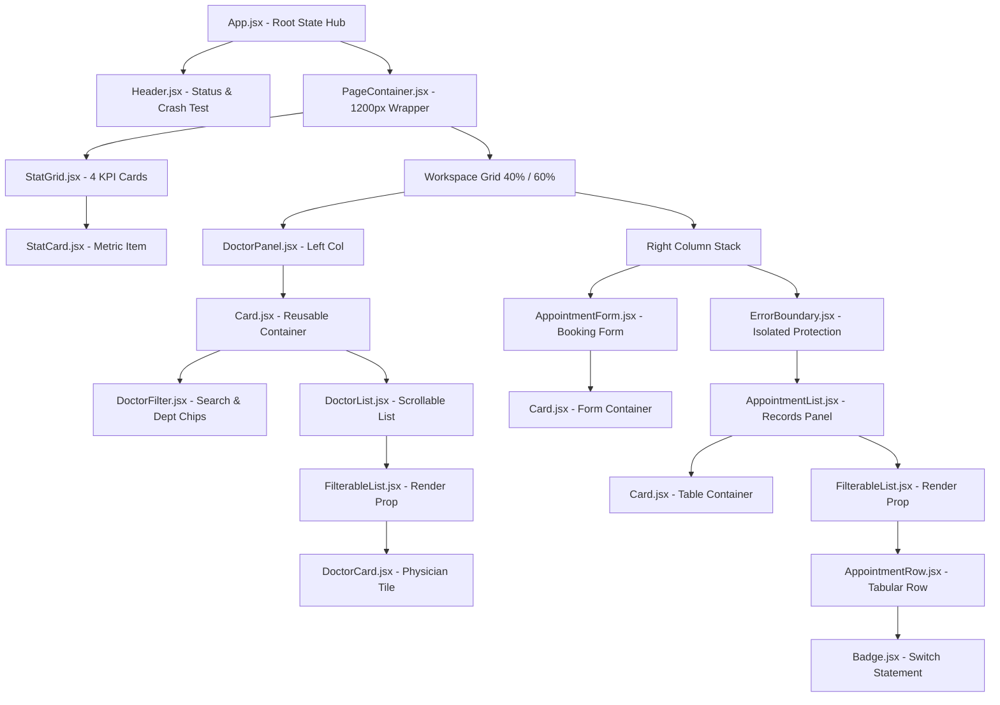

# MediCare Clinic — Front Desk Appointment Dashboard

[](https://react.dev/)
[](https://vitejs.dev/)
[](https://developer.mozilla.org/en-US/docs/Web/JavaScript)
[](https://www.w3.org/Style/CSS/)
[](LICENSE)

> **React Batch-9 | Module-26 Assignment Official Submission**  
> **Repository:** [https://github.com/BipronathSaha12/MediCare-Clinic.git](https://github.com/BipronathSaha12/MediCare-Clinic.git)  
> A pixel-accurate, single-page hospital front-desk appointment dashboard engineered with **React + Vite**. The entire application operates 100% on local hard-coded seed data within reactive React state (zero external UI kits, zero backend/REST APIs, zero router/Redux overhead).

---

## Table of Contents
1. [Clinical Use Cases & Front-Desk Workflow](#1-clinical-use-cases--front-desk-workflow)
2. [Developer Quick Start & Toolchain](#2-developer-quick-start--toolchain)
3. [Architecture & System Design](#3-architecture--system-design)
4. [Component Hierarchy & Data Flow](#4-component-hierarchy--data-flow)
5. [React Core Concepts & Grading Registry (REQ-1 to REQ-12)](#5-react-core-concepts--grading-registry-req-1-to-req-12)
6. [Architectural Deep Dives](#6-architectural-deep-dives)
   - [6.1 Prop Drilling Analysis & Solutions (REQ-9)](#61-prop-drilling-analysis--solutions-req-9)
   - [6.2 Error Handling & 3-Tier Fault Tolerance (REQ-11 & REQ-12)](#62-error-handling--3-tier-fault-tolerance-req-11--req-12)
   - [6.3 Controlled vs Uncontrolled Forms (REQ-7 & REQ-8)](#63-controlled-vs-uncontrolled-forms-req-7--req-8)
7. [Design Tokens & 30-Pin Visual Specifications](#7-design-tokens--30-pin-visual-specifications)
8. [Seed Data & Metric Alignment](#8-seed-data--metric-alignment)
9. [Developer Guide & Extensibility Roadmap](#9-developer-guide--extensibility-roadmap)
10. [Deployment Instructions](#10-deployment-instructions)

---

## 1. Clinical Use Cases & Front-Desk Workflow

MediCare Clinic Front Desk Dashboard provides medical receptionists with a centralized operational workspace to manage daily clinic consultations with zero latency:

```
[ Receptionist Workflow ]
       │
       ├──► 1. Triage & Overview ──► Check real-time KPI metrics (Doctors, Appointments, Pending Queue)
       │
       ├──► 2. Doctor Discovery ───► Search by physician name & filter by specialty department
       │
       ├──► 3. Patient Booking ────► Select doctor (auto-syncs form) + enter patient details & attach file
       │
       └──► 4. Schedule Management ─► Filter by status, update lifecycle (Pending ➜ Confirmed ➜ Completed)
```

- **Live Triage & Queue Monitoring**: Instantly view clinic load via KPI cards and header operational tags (`All Caught Up`, `Active`, `High Queue`).
- **Physician Filtering & Availability Checking**: Filter doctors across **Cardiology**, **Neurology**, **Medicine**, and **Orthopedics**. Physicians marked `available: false` visually indicate "Not available" and disable booking.
- **Synchronized Scheduling**: Selecting a physician from the doctor panel automatically populates and locks the doctor select field in the booking form via lifted state.
- **Consultation Lifecycle Management**: Update any appointment's status inline (`Pending`, `Confirmed`, `Completed`, `Cancelled`) with live color-coded badge transitions and automatic KPI metric recalculation.
- **Safe Patient Record Deletion**: Immediate removal of appointments with native browser confirmation dialogs (`window.confirm`).

---

## 2. Developer Quick Start & Toolchain

### Prerequisites
- **Node.js**: `v18.0.0` or higher (verified on Node `v24.x`)
- **Package Manager**: `npm` `v9.0.0` or higher
- **Web Browser**: Mozilla Firefox, Google Chrome, Microsoft Edge, or Apple Safari

### Local Setup Instructions

```bash
# 1. Clone the GitHub repository
git clone https://github.com/BipronathSaha12/MediCare-Clinic.git

# 2. Navigate to project root
cd MediCare-Clinic

# 3. Install dependencies
npm install

# 4. Start local development server with Hot Module Replacement (HMR)
npm run dev

# 5. Open browser at http://localhost:3000
```

### CLI Command Reference

| Command | Action | Description |
| :--- | :--- | :--- |
| `npm run dev` | Dev Server | Launches Vite dev server at `http://localhost:3000` with active HMR. |
| `npm run build` | Production Build | Compiles and optimizes assets into `dist/` with gzip size analysis. |
| `npm run preview` | Production Preview | Locally serves production `dist/` bundle on port `4173` for testing. |

---

## 3. Architecture & System Design

The application follows an **Unidirectional Data Flow** with a **3-Tier Responsive Spatial Architecture**:

```
┌────────────────────────────────────────────────────────────────────────┐
│ Tier 1: Sticky Navigation Bar (72px, Brand, Status IIFE, Crash Test)   │
├────────────────────────────────────────────────────────────────────────┤
│ Tier 2: Summary Metric KPI Grid (4 Columns: 🩺 Doctors, 📅 Appts, ...) │
├────────────────────────────────────┬───────────────────────────────────┤
│ Tier 3: Left Column (40%)          │ Tier 3: Right Column (60%)        │
│                                    │                                   │
│  ┌──────────────────────────────┐  │  ┌──────────────────────────────┐ │
│  │ DoctorPanel (Card)           │  │  │ AppointmentForm (Card)       │ │
│  │  ├─ Search Input             │  │  │  ├─ Controlled Inputs        │ │
│  │  ├─ Department Chips         │  │  │  ├─ Uncontrolled File Ref    │ │
│  │  └─ DoctorList (Scrollable)  │  │  │  └─ Validation Engine        │ │
│  │      └─ FilterableList (RP)  │  │  └──────────────────────────────┘ │
│  │          └─ DoctorCard       │  │  ┌──────────────────────────────┐ │
│  └──────────────────────────────┘  │  │ Isolated ErrorBoundary       │ │
│                                    │  │  └─ AppointmentList (Card)   │ │
│                                    │  │      ├─ Status Filter Chips  │ │
│                                    │  │      └─ Appointments Table   │ │
│                                    │  │          └─ AppointmentRow   │ │
│                                    │  └──────────────────────────────┘ │
├────────────────────────────────────┴───────────────────────────────────┤
│ Footer (MediCare Clinic © 2026 · Built with React)                     │
└────────────────────────────────────────────────────────────────────────┘
```

---

## 4. Component Hierarchy & Data Flow



---

## 5. React Core Concepts & Grading Registry (REQ-1 to REQ-12)

Every mandatory assignment rubric evaluation tag is placed in the code in the exact format required:

| Rubric Tag | Core React Concept | Location | Implementation Details |
| :--- | :--- | :--- | :--- |
| **`// [REQ-1]`** | List rendering with `.map()` and stable `key` | [`DoctorFilter.jsx`](src/components/doctors/DoctorFilter.jsx)<br>[`DoctorList.jsx`](src/components/doctors/DoctorList.jsx)<br>[`AppointmentList.jsx`](src/components/appointments/AppointmentList.jsx)<br>[`FilterableList.jsx`](src/components/ui/FilterableList.jsx) | Renders collections (`doctors`, `appointments`, `departments`, `statusTabs`) using unique immutable IDs (`doctor.id`, `appointment.id`, `dept`). Array indexes are **never** used as keys. |
| **`// [REQ-2a]`** | Ternary operator (`cond ? a : b`) | [`DoctorCard.jsx`](src/components/doctors/DoctorCard.jsx)<br>[`FilterableList.jsx`](src/components/ui/FilterableList.jsx)<br>[`AppointmentList.jsx`](src/components/appointments/AppointmentList.jsx) | Select button label (`isSelected ? 'Selected' : 'Select'`) and list rendering (`items.length === 0 ? <EmptyState /> : <List />`). |
| **`// [REQ-2b]`** | Logical `&&` operator | [`AppointmentForm.jsx`](src/components/appointments/AppointmentForm.jsx)<br>[`DoctorCard.jsx`](src/components/doctors/DoctorCard.jsx) | Auto-hiding green booking success alert (`✓ Appointment booked...`), inline validation errors, and `"Not available"` badges. |
| **`// [REQ-2c]`** | `switch` statement | [`Badge.jsx`](src/components/ui/Badge.jsx) | `switch (status)` resolves exact color tokens and indicator dots for `'Pending'`, `'Confirmed'`, `'Completed'`, and `'Cancelled'`. |
| **`// [REQ-2d]`** | IIFE inside JSX | [`Header.jsx`](src/components/layout/Header.jsx) | `{(() => { ... })()}` calculates real-time triage queue status tags directly within JSX without polluting component namespace. |
| **`// [REQ-3]`** | Lifting state up | [`App.jsx`](src/App.jsx) | `selectedDoctorId` and `appointments` live in `App.jsx`. Selecting a physician highlights their card and syncs the booking form dropdown. |
| **`// [REQ-4]`** | Passing callback props parent → child | [`App.jsx`](src/App.jsx) | Passes downward handlers: `onSelectDoctor`, `onAddAppointment`, `onStatusChange`, `onDeleteAppointment`, and `onResetDoctor`. |
| **`// [REQ-5]`** | Component composition via `children` | [`Card.jsx`](src/components/ui/Card.jsx) | Reusable `<Card title="..." count={...}>{children}</Card>` wraps `DoctorPanel`, `AppointmentForm`, and `AppointmentList`. |
| **`// [REQ-6]`** | Render prop pattern | [`FilterableList.jsx`](src/components/ui/FilterableList.jsx) | Generic `<FilterableList items={...} renderItem={(item) => ...} />` decouples iteration/filtering mechanics from presentation. |
| **`// [REQ-7]`** | Controlled components | [`AppointmentForm.jsx`](src/components/appointments/AppointmentForm.jsx) | `patientName`, `phone`, `doctorId`, `date`, `time`, and `note` are strictly managed via React `useState`. |
| **`// [REQ-8]`** | Uncontrolled component with `useRef` | [`AppointmentForm.jsx`](src/components/appointments/AppointmentForm.jsx) | Direct DOM reference `fileInputRef = useRef(null)` binds the report attachment input; read on submit and cleared on reset. |
| **`// [REQ-9]`** | Prop drilling problem & solution | [`App.jsx`](src/App.jsx)<br>[`DoctorPanel.jsx`](src/components/doctors/DoctorPanel.jsx) | Resolves raw prop threading across `App -> DoctorPanel -> DoctorList -> DoctorCard` via component composition and render props. |
| **`// [REQ-10]`** | Event handling & form submit | [`AppointmentForm.jsx`](src/components/appointments/AppointmentForm.jsx)<br>[`AppointmentRow.jsx`](src/components/appointments/AppointmentRow.jsx)<br>[`DoctorCard.jsx`](src/components/doctors/DoctorCard.jsx) | Form submit with `e.preventDefault()` & `try/catch`; row deletion with `window.confirm()`; doctor card selection toggle. |
| **`// [REQ-11]`** | Error Boundary + Fallback UI | [`ErrorBoundary.jsx`](src/components/error/ErrorBoundary.jsx)<br>[`FallbackUI.jsx`](src/components/error/FallbackUI.jsx)<br>[`CrashTest.jsx`](src/components/error/CrashTest.jsx) | React class boundary with `getDerivedStateFromError` & `componentDidCatch`. Top-level boundary + isolated boundary around Appointments. |
| **`// [REQ-12]`** | Global error handling + logger | [`logger.js`](src/utils/logger.js)<br>[`main.jsx`](src/main.jsx) | Timestamped console logging (`logInfo`, `logWarn`, `logError`) + `window.onerror` and `window.addEventListener('unhandledrejection')`. |

---

## 6. Architectural Deep Dives

### 6.1 Prop Drilling Analysis & Solutions (REQ-9)

#### What was the problem?
When building modular component trees, child components often need data or handlers stored at the root:
```text
App (holds selectedDoctorId and onSelectDoctor)
 └── DoctorPanel (does NOT use selectedDoctorId directly)
      └── DoctorList (does NOT use selectedDoctorId directly)
           └── DoctorCard (consumes selectedDoctorId to render "Selected" state)
```
In this naive architecture:
- Both `DoctorPanel` and `DoctorList` act as **"dumb pass-through pipes"** (prop drilling).
- Adding or renaming a prop on `DoctorCard` requires refactoring every intermediate file.
- It degrades testability and creates tight architectural coupling.

#### How We Solved It
1. **Component Composition (`children` prop)**:
   By structuring `Card.jsx` to render `props.children`, the container does not need to know what props its children require.
2. **Render Prop Pattern (`FilterableList.jsx`)**:
   `DoctorList` delegates iteration to `FilterableList`, passing a `renderItem={(doctor) => <DoctorCard ... />}` callback. The consumer defines component bindings directly at the instantiation call site.
3. **Enterprise Alternative (React Context Comparison)**:
   In larger applications with deeply nested component trees (>4 levels), a `ClinicContext` (`createContext` + `useContext`) can supply state globally:
   ```jsx
   // Context Example (Bonus Architectural Pattern):
   const ClinicContext = React.createContext(null);
   export const useClinic = () => React.useContext(ClinicContext);
   ```
   *Trade-off*: Context adds implicit global dependencies and can cause unnecessary re-renders across consumers; **Component Composition** and **Render Props** provide explicit, clean, and highly performant data flow without boilerplate.

---

### 6.2 Error Handling & 3-Tier Fault Tolerance (REQ-11 & REQ-12)

#### Why React `ErrorBoundary` Alone is Insufficient
Many developers assume wrapping an app in `<ErrorBoundary>` catches every runtime crash. It does **not**:
1. **Event Handlers**: Code inside `onClick` or `onSubmit` executes during browser event callbacks, outside React's render/reconciliation phase.
2. **Asynchronous Code**: Unhandled promises (`fetch`, `async/await`), `setTimeout`, or `requestAnimationFrame` escape the component boundary.
3. **Errors in ErrorBoundary Itself**: An error boundary cannot catch errors thrown inside its own `render()` method.

#### Our Complete 3-Tier Defense
```
Tier 1: Declarative Render Boundary ──► ErrorBoundary.jsx (catches rendering/lifecycle throws)
Tier 2: Imperative Event Handlers   ──► try / catch in AppointmentForm.jsx (logs & shows banner)
Tier 3: Global Window Catchers      ──► window.onerror & unhandledrejection in main.jsx
```

1. **Top-Level & Isolated Boundaries**:
   - The entire `<App />` is wrapped in a top-level boundary.
   - `<AppointmentList />` is wrapped in its own isolated `<ErrorBoundary name="Appointments Panel">`. If a corrupted appointment record fails to render, **only that table crashes into a local fallback card**; the physician catalog and booking form remain fully interactive!
2. **Fallback UI**: Displays a warning title, an explanation that the rest of the application is operating normally, a collapsible `<details>` block with error stack trace, and a **"Try Again"** recovery button.
3. **Crash Test Trigger**: Header button `💥 Crash Test` intentionally triggers a synchronous render error to demonstrate error boundary trapping and user recovery.

---

### 6.3 Controlled vs Uncontrolled Forms (REQ-7 & REQ-8)

- **Controlled Inputs (`useState`)**: `patientName`, `phone`, `doctorId`, `date`, `time`, and `note` update on every keystroke, allowing real-time button disabling, dynamic field validation, and instant feedback.
- **Uncontrolled Component (`useRef`)**: The file input for medical reports does not require state synchronization on every frame. A direct DOM reference (`fileInputRef`) reads the file metadata imperatively upon submit and clears the input DOM value upon reset.

---

## 7. Design Tokens & 30-Pin Visual Specifications

Styled exclusively with clean, standard CSS custom properties in `src/index.css`:

### Color Tokens
```css
--bg-page: #F1F5F9;         /* Body canvas background */
--bg-surface: #FFFFFF;      /* Cards, modals, sticky header */
--border-color: #E2E8F0;    /* Structural borders, dividers, inputs */
--primary: #0F766E;         /* Brand teal, primary buttons, active chips */
--primary-soft: #CCFBF1;    /* Avatar tiles, selected doctor background, count pills */
--text-primary: #0F172A;    /* Primary headers, stat numbers */
--text-muted: #64748B;      /* Helper labels, table headers */
--pending-text: #B45309;    --pending-bg: #FEF3C7;
--confirmed-text: #1D4ED8;  --confirmed-bg: #DBEAFE;
--completed-text: #15803D;  --completed-bg: #DCFCE7;
--cancelled-text: #B91C1C;  --cancelled-bg: #FEE2E2;
--danger: #DC2626;          /* Delete action, error banners, crash test */
```

### 30-Pin Specification Conformance Matrix
- **Pin 1 (Header)**: `position: sticky; top: 0; z-index: 50; height: 72px; background: #FFFFFF; border-bottom: 1px solid #E2E8F0`.
- **Pin 2 (Brand Block)**: Circular badge `36px x 36px` (`#0F766E`) with white `"M"`, title `"MediCare Clinic"` (`20px/700`), subtitle (`14px #64748B`), and dynamic IIFE tag.
- **Pin 3 (Crash Test)**: `1px solid #DC2626`, `#DC2626` text, white background, `border-radius: 8px`, `padding: 8px 16px`, `font-weight: 600`.
- **Pin 4 (Stat Grid)**: 4 equal columns (`gap: 20px`) inside centered container (`max-width: 1200px; padding: 24px`).
- **Pin 5 (Stat Card)**: `#FFFFFF`, `1px solid #E2E8F0`, `radius: 12px`, `padding: 20px`, `shadow: 0 1px 2px rgba(15, 23, 42, 0.06)`.
- **Pin 6 (Stat Typography)**: Label `13px/500 #64748B UPPERCASE`, value `28px/700 #0F172A` formatted as 2 digits (`08`, `12`, `05`, `04`).
- **Pin 7 (Stat Icon Tile)**: `40px x 40px`, `radius: 10px`, background `#CCFBF1`, centered emoji (`🩺`, `📅`, `⏳`, `✅`).
- **Pin 8 (Workspace Grid)**: Left 40% (`DoctorPanel`), Right 60% (`AppointmentForm` + `AppointmentList`), `gap: 24px`.
- **Pin 9 (Doctor Search)**: Full width input, `radius: 8px`, `1px solid #E2E8F0`, placeholder `"🔍 Search doctor by name..."`.
- **Pin 10 & 11 (Filter Chips)**: Active (`#0F766E` bg, white text); Inactive (`#FFFFFF` bg, `#64748B` text, `1px solid #E2E8F0`).
- **Pin 12 (Selected Doctor Card)**: Background `#CCFBF1`, border `#0F766E`, left border `3px solid #0F766E`, button label `"Selected"`.
- **Pin 13 (Doctor Hover)**: Border `#0F766E`, box shadow `0 4px 10px rgba(15, 23, 42, 0.10)`.
- **Pin 14 (Doctor Avatar Tile)**: `42px x 42px`, `radius: 10px`, initials (`14px/700 #0F766E`) on `#CCFBF1` (or `#FFFFFF` when selected).
- **Pin 15 (Unavailable State)**: Badge `"Not available"` (`#B91C1C` on `#FEE2E2`), disabled Select button (`opacity: 0.5`).
- **Pin 16 (Header Count Pill)**: Title (`16px/600`), count pill (`12px/600 #0F766E` on `#CCFBF1`, `padding: 2px 10px`).
- **Pin 17 (Input Focus)**: `outline: 2px solid #0F766E; border-color: transparent`. Field label with red asterisk `*`.
- **Pin 18 (Validation Error)**: `12px #DC2626`, rendered directly below invalid input.
- **Pin 19 (Date + Time Row)**: 2 equal columns (`gap: 14px`), collapsing to 1 column below `640px`.
- **Pin 20 (Uncontrolled File Input)**: Dashed container (`1px dashed #E2E8F0`, `#F8FAFC` bg, `padding: 10px 12px`, `radius: 8px`).
- **Pin 21 (Form Action Buttons)**: Primary submit (`#0F766E`, white text, disabled until valid) + secondary ghost Reset (`#FFFFFF`), `gap: 12px`.
- **Pin 22 (Status Filter Chips)**: `All (12)`, `Pending (5)`, `Confirmed (2)`, `Completed (4)`, `Cancelled (1)` with dynamic counts.
- **Pin 23 (Appointments Table)**: Header `12px/600 #64748B UPPERCASE`, row divider `1px solid #E2E8F0`, padding `12px 8px`.
- **Pins 24–27 (Status Badges)**: Color tokens mapped via `switch` in `Badge.jsx`.
- **Pin 28 (Per-Row Status Dropdown)**: Compact `<select>` below badge to immediately update status in React state.
- **Pin 29 (Delete Button)**: Text button in `#DC2626` triggering `window.confirm("Are you sure you want to delete this appointment?")`.
- **Pin 30 (Footer)**: Centered: `"MediCare Clinic © 2026 · Built with React"` (`13px #64748B`, `padding: 24px 0`).

---

## 8. Seed Data & Metric Alignment

Seed datasets in `src/data/doctors.js` and `src/data/appointments.js` align with the screenshot numbers:
- **Total Doctors**: `08` (4 departments: Cardiology, Neurology, Medicine, Orthopedics)
- **Total Appointments**: `12`
- **Pending Appointments**: `05`
- **Completed Appointments**: `04`
- **Confirmed Appointments**: `02`
- **Cancelled Appointments**: `01`
- `5 + 4 + 2 + 1 = 12 total appointments`

---

## 9. Developer Guide & Extensibility Roadmap

### Adding a New Doctor
To register an additional physician, append a new object to `src/data/doctors.js`:
```javascript
{
  id: 9,
  name: 'Dr. Shahriar Kabir',
  department: 'Dermatology', // Automatically generates a new department chip!
  specialization: 'MBBS, DDV',
  visitingFee: 1100,
  available: true
}
```

### Adding a New Appointment Lifecycle Status
1. Update `src/components/ui/Badge.jsx` with a new case in the `switch (status)` statement.
2. Add the status string to `statusTabs` in `src/components/appointments/AppointmentList.jsx`.
3. Add the `<option>` tag in `src/components/appointments/AppointmentRow.jsx`.

### Future REST API Integration Guide
When transitioning from local React state to a production backend:
1. Replace seed imports in `App.jsx` with a custom hook: `useAppointments()`.
2. Connect to an API endpoint using TanStack React Query:
   ```javascript
   const { data: appointments, isLoading } = useQuery({
     queryKey: ['appointments'],
     queryFn: () => fetch('/api/appointments').then(res => res.json())
   });
   ```
3. Convert `onAddAppointment`, `onStatusChange`, and `onDeleteAppointment` into React Query mutations (`useMutation`).

---

## 10. Deployment Instructions

### Deploying to Vercel
```bash
npm install -g vercel
vercel
```

### Deploying to Netlify
```bash
npm install -g netlify-cli
netlify deploy --build
```

### Deploying to GitHub Pages
1. In `vite.config.js`, set `base: '/MediCare-Clinic/'`.
2. Run `npm run build`.
3. Push the `dist/` directory to your `gh-pages` branch.

---

## License & Credits

Developed with precision for the **React Batch-9 | Module-26 Assignment**.  
Author: [Bipronath Saha](https://github.com/BipronathSaha12)  
Year: 2026
