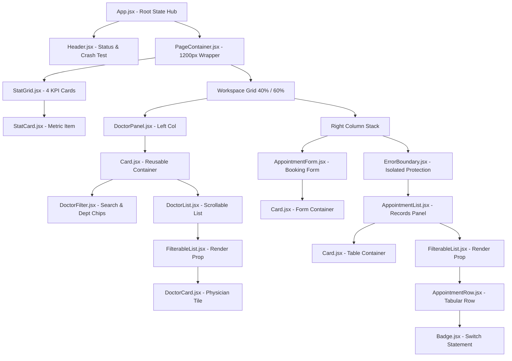

# MediCare Clinic — Front Desk Appointment Dashboard

[](https://react.dev/)
[](https://vitejs.dev/)
[](https://developer.mozilla.org/en-US/docs/Web/JavaScript)
[](https://www.w3.org/Style/CSS/)
[](LICENSE)
[](https://www.mozilla.org/firefox/)

> **React Batch-9 | Module-26 Assignment Official Submission**  
> **GitHub Repository:** [https://github.com/BipronathSaha12/MediCare-Clinic.git](https://github.com/BipronathSaha12/MediCare-Clinic.git)  
> A production-grade, single-page hospital front-desk appointment dashboard engineered with **React (JavaScript) + Vite**. The application operates 100% on local hard-coded seed data within reactive React state with zero external UI kits, zero backend/REST APIs, zero routing dependencies, and zero state management libraries.

---

## Table of Contents
1. [Uses & End-User Clinical Workflows](#1-uses--end-user-clinical-workflows)
2. [Developer Instructions & Operating Guide](#2-developer-instructions--operating-guide)
   - [2.1 Prerequisites & Toolchain](#21-prerequisites--toolchain)
   - [2.2 Quick Start & Installation](#22-quick-start--installation)
   - [2.3 Running with Mozilla Firefox (Senior Developer Method)](#23-running-with-mozilla-firefox-senior-developer-method)
   - [2.4 Production Build & Bundle Inspection](#24-production-build--bundle-inspection)
   - [2.5 Developer Testing & Verification Protocol](#25-developer-testing--verification-protocol)
   - [2.6 Developer Extensibility Cookbook (Adding Doctors, Fields & APIs)](#26-developer-extensibility-cookbook)
3. [Architecture & System Design](#3-architecture--system-design)
4. [Component Hierarchy & Spatial Layout](#4-component-hierarchy--spatial-layout)
5. [React Core Concepts Registry (REQ-1 to REQ-12)](#5-react-core-concepts-registry-req-1-to-req-12)
6. [Architectural Deep Dives](#6-architectural-deep-dives)
   - [6.1 Prop Drilling Analysis & Solutions (REQ-9)](#61-prop-drilling-analysis--solutions-req-9)
   - [6.2 3-Tier Error Handling & Fault Tolerance (REQ-11 & REQ-12)](#62-3-tier-error-handling--fault-tolerance-req-11--req-12)
   - [6.3 Controlled vs Uncontrolled Forms (REQ-7 & REQ-8)](#63-controlled-vs-uncontrolled-forms-req-7--req-8)
7. [Design Tokens & 30-Pin Visual Specifications](#7-design-tokens--30-pin-visual-specifications)
8. [Module-26 Viva & Technical Interview Defense Guide](#8-module-26-viva--technical-interview-defense-guide)
9. [Deployment Blueprint](#9-deployment-blueprint)

---

## 1. Uses & End-User Clinical Workflows

The dashboard provides medical receptionists and hospital administrators with an operational command center to manage outpatient department (OPD) traffic:

```
┌────────────────────────────────────────────────────────────────────────┐
│                      FRONT DESK RECEPTION WORKFLOW                     │
└────────────────────────────────────────────────────────────────────────┘
       │
       ├──► USE 1: Real-Time Operational Overview
       │    └─ Instantly monitor clinic load: Total Doctors (08), Total Appts (12),
       │       Pending Appts (05), and Completed Appts (04).
       │    └─ Dynamic IIFE header tag indicates triage queue pressure:
       │       [● All Caught Up] | [● Active (5 Pending)] | [● High Queue]
       │
       ├──► USE 2: Multi-Criteria Physician Discovery & Availability
       │    └─ Search doctors by name with instant live filtering.
       │    └─ Filter dynamically by department (Cardiology, Neurology, Medicine, Orthopedics).
       │    └─ View doctor visiting fee, qualifications, and real-time availability status.
       │    └─ Unavailable doctors display a red "Not available" badge and disable booking.
       │
       ├──► USE 3: Streamlined Patient Booking with Auto-Sync
       │    └─ Clicking "Select" on a doctor card highlights the card and auto-populates
       │       the doctor selection dropdown in the booking form (Lifted State).
       │    └─ Validate patient name (min 3 chars), Bangladeshi phone number (01XXXXXXXXX),
       │       appointment date (past dates blocked), and appointment time.
       │    └─ Attach optional medical records/prescriptions via an uncontrolled file input.
       │    └─ Submit booking: Instant auto-hiding success alert + prepended to table.
       │
       ├──► USE 4: Consultation Lifecycle Management
       │    └─ Filter appointment table by status: All, Pending, Confirmed, Completed, Cancelled.
       │    └─ Inline status mutation dropdown allows immediate state updates on each row.
       │    └─ Changing an appointment's status immediately updates the KPI counter cards.
       │
       └──► USE 5: Safe Patient Record Deletion & Fault Recovery
            └─ Delete consultations with browser confirmation (window.confirm).
            └─ Trigger intentional render error via "💥 Crash Test" to demonstrate
               isolated ErrorBoundary and FallbackUI recovery without crashing the page.
```

---

## 2. Developer Instructions & Operating Guide

### 2.1 Prerequisites & Toolchain
- **Node.js**: `v18.0.0` or higher (verified on Node `v24.14.0`)
- **Package Manager**: `npm` `v9.0.0` or higher (bundled with Node)
- **Git**: `v2.40.0` or higher
- **Supported Browsers**: Mozilla Firefox, Google Chrome, Microsoft Edge, Safari

---

### 2.2 Quick Start & Installation

```bash
# Step 1: Clone the remote repository
git clone https://github.com/BipronathSaha12/MediCare-Clinic.git

# Step 2: Enter the project codebase directory
cd MediCare-Clinic

# Step 3: Install all dependencies (clean install)
npm install

# Step 4: Run the development server with Hot Module Replacement
npm run dev

# Step 5: Open your browser at http://localhost:3000
```

---

### 2.3 Running with Mozilla Firefox (Senior Developer Method)

As a senior developer running this project with **Mozilla Firefox**:

#### Automatic Launch on Windows (PowerShell)
```powershell
# Start the Vite development server in the background
npm run dev

# In a separate terminal (or background session), launch Firefox directly:
Start-Process firefox "http://localhost:3000"
```

#### Automatic Launch on macOS / Linux
```bash
# macOS
npm run dev &
open -a Firefox "http://localhost:3000"

# Linux
npm run dev &
firefox "http://localhost:3000" &
```

#### Configuring Vite to Always Target Firefox
You can also launch Vite with the `BROWSER` environment variable set:
```bash
# Windows PowerShell
$env:BROWSER="firefox"; npm run dev

# macOS / Linux / Bash
BROWSER=firefox npm run dev
```

---

### 2.4 Production Build & Bundle Inspection

To test production bundling, tree-shaking, and minification:

```bash
# Execute production build
npm run build
```

**Expected Build Output**:
```text
✓ 53 modules transformed.
dist/index.html                   1.03 kB │ gzip:  0.58 kB
dist/assets/index-D8ymT4gx.css   14.81 kB │ gzip:  3.31 kB
dist/assets/index-sS6i9Zv6.js   248.32 kB │ gzip: 77.25 kB
✓ built in 1.33s
```

#### Local Production Preview
```bash
# Test the compiled production artifacts locally
npm run preview

# Serves production build at http://localhost:4173/
```

---

### 2.5 Developer Testing & Verification Protocol

When contributing to or evaluating this codebase, execute the following verification steps:

| Step | Test Objective | Action | Expected Result |
| :---: | :--- | :--- | :--- |
| **1** | **KPI Counters** | Load application in Firefox | Stat cards show `08` Total Doctors, `12` Total Appts, `05` Pending, `04` Completed. |
| **2** | **Doctor Search** | Type `"Ayesha"` in search box | Only Dr. Ayesha Rahman card remains visible. Clear search restores all 8 cards. |
| **3** | **Department Filter** | Click `"Cardiology"` chip | Chip becomes active (teal); only Cardiology doctors (Dr. Ayesha, Dr. Farzana) render. |
| **4** | **Lifted State Sync** | Click `"Select"` on Dr. Mahmud Karim | Doctor card turns teal, button reads `"Selected"`, and Appointment Form select updates to Dr. Mahmud. |
| **5** | **Form Validation** | Submit empty form | Submit button is disabled; input fields highlight red with specific validation messages. |
| **6** | **Uncontrolled File** | Select a `.pdf` file in file input | File input reads filename via `useRef` on submit and logs payload without triggering re-render. |
| **7** | **New Booking** | Fill valid data & click Confirm | Green success banner appears; total appointments becomes `13`, pending becomes `06`, row is prepended. |
| **8** | **Status Dropdown** | Change any row from Pending to Confirmed | Row badge turns blue (`Confirmed`), Pending stat counter drops by 1. |
| **9** | **Row Deletion** | Click `"Delete"` on appointment | Prompts `window.confirm()`; on approval, removes record from state and updates counters. |
| **10** | **Error Boundary** | Click `"💥 Crash Test"` in Header | Top-level ErrorBoundary catches throw; renders FallbackUI with collapsible stack and "Try Again". |
| **11** | **Isolated Boundary** | Error in AppointmentList | Only the appointments panel renders FallbackUI; doctor catalog and booking form remain fully interactive! |

---

### 2.6 Developer Extensibility Cookbook

#### A. How to Register a New Doctor
Open [`src/data/doctors.js`](src/data/doctors.js) and append a new doctor record:
```javascript
{
  id: 9,
  name: 'Dr. Shahriar Kabir',
  department: 'Dermatology', // Automatically creates a new department filter chip!
  specialization: 'MBBS, DDV (Dermatology)',
  visitingFee: 1100,
  available: true
}
```
*Note: Because department filter chips are derived dynamically using `Array.from(new Set(doctors.map(d => d.department)))`, adding a new department automatically generates its UI filter chip with zero hardcoding!*

#### B. How to Add a New Appointment Status
1. Open [`src/components/ui/Badge.jsx`](src/components/ui/Badge.jsx) and add a new case to `getBadgeStyle(status)`:
   ```javascript
   case 'In-Consultation':
     return { className: 'badge badge-in-consultation', dotColor: '#7C3AED', label: 'In-Consultation' };
   ```
2. Open [`src/index.css`](src/index.css) and define color tokens:
   ```css
   --in-consultation-text: #7C3AED;
   --in-consultation-bg: #EDE9FE;
   ```
3. Add `'In-Consultation'` to `statusTabs` in [`src/components/appointments/AppointmentList.jsx`](src/components/appointments/AppointmentList.jsx) and `<option>` in [`src/components/appointments/AppointmentRow.jsx`](src/components/appointments/AppointmentRow.jsx).

#### C. Migrating from Local State to a Production REST API
To transition this frontend from local seed data to a production backend:
1. Replace seed initialization in [`src/App.jsx`](src/App.jsx) with React Query / TanStack Query:
   ```javascript
   // Future API Hook Example:
   import { useQuery, useMutation, useQueryClient } from '@tanstack/react-query';

   const { data: doctors = [] } = useQuery({
     queryKey: ['doctors'],
     queryFn: () => fetch('/api/v1/doctors').then(res => res.json())
   });

   const { data: appointments = [] } = useQuery({
     queryKey: ['appointments'],
     queryFn: () => fetch('/api/v1/appointments').then(res => res.json())
   });
   ```
2. Mutate state using `useMutation` for `createAppointment`, `updateStatus`, and `deleteAppointment`.

---

## 3. Architecture & System Design

The application follows an **Unidirectional Data Flow** with a **3-Tier Spatial Layout Model**:

```
┌────────────────────────────────────────────────────────────────────────┐
│ Tier 1: Sticky Navigation Bar (72px, Brand, Status IIFE, Crash Test)   │
├────────────────────────────────────────────────────────────────────────┤
│ Tier 2: Summary Metric KPI Grid (4 Columns: 🩺 Doctors, 📅 Appts, ...) │
├────────────────────────────────────┬───────────────────────────────────┤
│ Tier 3: Left Column (40%)          │ Tier 3: Right Column (60%)        │
│                                    │                                   │
│  ┌──────────────────────────────┐  │  ┌──────────────────────────────┐ │
│  │ DoctorPanel (Card)           │  │  │ AppointmentForm (Card)       │ │
│  │  ├─ Search Input             │  │  │  ├─ Controlled Inputs        │ │
│  │  ├─ Department Chips         │  │  │  ├─ Uncontrolled File Ref    │ │
│  │  └─ DoctorList (Scrollable)  │  │  │  └─ Validation Engine        │ │
│  │      └─ FilterableList (RP)  │  │  └──────────────────────────────┘ │
│  │          └─ DoctorCard       │  │  ┌──────────────────────────────┐ │
│  └──────────────────────────────┘  │  │ Isolated ErrorBoundary       │ │
│                                    │  │  └─ AppointmentList (Card)   │ │
│                                    │  │      ├─ Status Filter Chips  │ │
│                                    │  │      └─ Appointments Table   │ │
│                                    │  │          └─ AppointmentRow   │ │
│                                    │  └──────────────────────────────┘ │
├────────────────────────────────────┴───────────────────────────────────┤
│ Footer (MediCare Clinic © 2026 · Built with React)                     │
└────────────────────────────────────────────────────────────────────────┘
```

---

## 4. Component Hierarchy & Spatial Layout



---

## 5. React Core Concepts Registry (REQ-1 to REQ-12)

Every mandatory rubric evaluation tag is placed in the code in the exact format required:

| Rubric Tag | Core React Concept | Location | Implementation Details |
| :--- | :--- | :--- | :--- |
| **`// [REQ-1]`** | List rendering with `.map()` and stable `key` | [`DoctorFilter.jsx`](src/components/doctors/DoctorFilter.jsx)<br>[`DoctorList.jsx`](src/components/doctors/DoctorList.jsx)<br>[`AppointmentList.jsx`](src/components/appointments/AppointmentList.jsx)<br>[`FilterableList.jsx`](src/components/ui/FilterableList.jsx) | Renders collections (`doctors`, `appointments`, `departments`, `statusTabs`) using unique immutable IDs (`doctor.id`, `appointment.id`, `dept`). Array indexes are **never** used as keys. |
| **`// [REQ-2a]`** | Ternary operator (`cond ? a : b`) | [`DoctorCard.jsx`](src/components/doctors/DoctorCard.jsx)<br>[`FilterableList.jsx`](src/components/ui/FilterableList.jsx)<br>[`AppointmentList.jsx`](src/components/appointments/AppointmentList.jsx) | Select button label (`isSelected ? 'Selected' : 'Select'`) and list rendering (`items.length === 0 ? <EmptyState /> : <List />`). |
| **`// [REQ-2b]`** | Logical `&&` operator | [`AppointmentForm.jsx`](src/components/appointments/AppointmentForm.jsx)<br>[`DoctorCard.jsx`](src/components/doctors/DoctorCard.jsx) | Auto-hiding green booking success alert (`✓ Appointment booked...`), inline validation errors, and `"Not available"` badges. |
| **`// [REQ-2c]`** | `switch` statement | [`Badge.jsx`](src/components/ui/Badge.jsx) | `switch (status)` resolves exact color tokens and indicator dots for `'Pending'`, `'Confirmed'`, `'Completed'`, and `'Cancelled'`. |
| **`// [REQ-2d]`** | IIFE inside JSX | [`Header.jsx`](src/components/layout/Header.jsx) | `{(() => { ... })()}` calculates real-time triage queue status tags directly within JSX without polluting component namespace. |
| **`// [REQ-3]`** | Lifting state up | [`App.jsx`](src/App.jsx) | `selectedDoctorId` and `appointments` live in `App.jsx`. Selecting a physician highlights their card and syncs the booking form dropdown. |
| **`// [REQ-4]`** | Passing callback props parent → child | [`App.jsx`](src/App.jsx) | Passes downward handlers: `onSelectDoctor`, `onAddAppointment`, `onStatusChange`, `onDeleteAppointment`, and `onResetDoctor`. |
| **`// [REQ-5]`** | Component composition via `children` | [`Card.jsx`](src/components/ui/Card.jsx) | Reusable `<Card title="..." count={...}>{children}</Card>` wraps `DoctorPanel`, `AppointmentForm`, and `AppointmentList`. |
| **`// [REQ-6]`** | Render prop pattern | [`FilterableList.jsx`](src/components/ui/FilterableList.jsx) | Generic `<FilterableList items={...} renderItem={(item) => ...} />` decouples iteration/filtering mechanics from presentation. |
| **`// [REQ-7]`** | Controlled components | [`AppointmentForm.jsx`](src/components/appointments/AppointmentForm.jsx) | `patientName`, `phone`, `doctorId`, `date`, `time`, and `note` are strictly managed via React `useState`. |
| **`// [REQ-8]`** | Uncontrolled component with `useRef` | [`AppointmentForm.jsx`](src/components/appointments/AppointmentForm.jsx) | Direct DOM reference `fileInputRef = useRef(null)` binds the report attachment input; read on submit and cleared on reset. |
| **`// [REQ-9]`** | Prop drilling problem & solution | [`App.jsx`](src/App.jsx)<br>[`DoctorPanel.jsx`](src/components/doctors/DoctorPanel.jsx) | Resolves raw prop threading across `App -> DoctorPanel -> DoctorList -> DoctorCard` via component composition and render props. |
| **`// [REQ-10]`** | Event handling & form submit | [`AppointmentForm.jsx`](src/components/appointments/AppointmentForm.jsx)<br>[`AppointmentRow.jsx`](src/components/appointments/AppointmentRow.jsx)<br>[`DoctorCard.jsx`](src/components/doctors/DoctorCard.jsx) | Form submit with `e.preventDefault()` & `try/catch`; row deletion with `window.confirm()`; doctor card selection toggle. |
| **`// [REQ-11]`** | Error Boundary + Fallback UI | [`ErrorBoundary.jsx`](src/components/error/ErrorBoundary.jsx)<br>[`FallbackUI.jsx`](src/components/error/FallbackUI.jsx)<br>[`CrashTest.jsx`](src/components/error/CrashTest.jsx) | React class boundary with `getDerivedStateFromError` & `componentDidCatch`. Top-level boundary + isolated boundary around Appointments. |
| **`// [REQ-12]`** | Global error handling + logger | [`logger.js`](src/utils/logger.js)<br>[`main.jsx`](src/main.jsx) | Timestamped console logging (`logInfo`, `logWarn`, `logError`) + `window.onerror` and `window.addEventListener('unhandledrejection')`. |

---

## 6. Architectural Deep Dives

### 6.1 Prop Drilling Analysis & Solutions (REQ-9)

#### The Problem
In hierarchical React component structures:
```text
App (manages selectedDoctorId state)
 └── DoctorPanel (does NOT use selectedDoctorId directly)
      └── DoctorList (does NOT use selectedDoctorId directly)
           └── DoctorCard (consumes selectedDoctorId to render "Selected" state)
```
In this naive architecture:
- `DoctorPanel` and `DoctorList` act as **blind pass-through intermediaries**.
- Modifying `DoctorCard`'s props requires updating every intermediate component signature.
- It introduces boilerplate clutter, increases refactoring friction, and violates separation of concerns.

#### How We Solved It
1. **Component Composition (`children` prop)**:
   `Card.jsx` provides a presentation container rendering `props.children`, allowing `DoctorFilter` and `DoctorList` to be composed directly inside `DoctorPanel`.
2. **Render Prop Pattern (`FilterableList.jsx`)**:
   `DoctorList` delegates iteration to `FilterableList`, passing a `renderItem={(doctor) => <DoctorCard ... />}` callback. The consumer binds props directly to `DoctorCard` at the render site.
3. **Enterprise Alternative (React Context Comparison)**:
   In larger applications with deeply nested component trees (>4 levels), a `ClinicContext` (`createContext` + `useContext`) can supply state globally:
   ```jsx
   // Context Example (Bonus Architectural Pattern):
   const ClinicContext = React.createContext(null);
   export const useClinic = () => React.useContext(ClinicContext);
   ```
   *Trade-off*: Context adds implicit global dependencies and can trigger wider re-renders unless memoized; **Component Composition** and **Render Props** provide explicit, clean, and highly performant data flow without boilerplate.

---

### 6.2 3-Tier Error Handling & Fault Tolerance (REQ-11 & REQ-12)

#### Why React `ErrorBoundary` Alone is Insufficient
Many developers assume wrapping an app in `<ErrorBoundary>` catches every runtime crash. It does **not**:
1. **Event Handlers**: Code inside `onClick` or `onSubmit` executes during browser event callbacks, outside React's render/reconciliation phase.
2. **Asynchronous Code**: Unhandled promises (`fetch`, `async/await`), `setTimeout`, or `requestAnimationFrame` escape the component boundary.
3. **Errors in ErrorBoundary Itself**: An error boundary cannot catch errors thrown inside its own `render()` method.

#### Our Complete 3-Tier Defense
```
Tier 1: Declarative Render Boundary ──► ErrorBoundary.jsx (catches rendering/lifecycle throws)
Tier 2: Imperative Event Handlers   ──► try / catch in AppointmentForm.jsx (logs & shows banner)
Tier 3: Global Window Catchers      ──► window.onerror & unhandledrejection in main.jsx
```

1. **Top-Level & Isolated Boundaries**:
   - The entire `<App />` is wrapped in a top-level boundary.
   - `<AppointmentList />` is wrapped in its own isolated `<ErrorBoundary name="Appointments Panel">`. If a corrupted appointment record fails to render, **only that table crashes into a local fallback card**; the physician catalog and booking form remain fully interactive!
2. **Fallback UI**: Displays a warning title, an explanation that the rest of the application is operating normally, a collapsible `<details>` block with error stack trace, and a **"Try Again"** recovery button.
3. **Crash Test Trigger**: Header button `💥 Crash Test` intentionally triggers a synchronous render error to demonstrate error boundary trapping and user recovery.

---

### 6.3 Controlled vs Uncontrolled Forms (REQ-7 & REQ-8)

- **Controlled Inputs (`useState`)**: `patientName`, `phone`, `doctorId`, `date`, `time`, and `note` update on every keystroke, allowing real-time button disabling, dynamic field validation, and instant feedback.
- **Uncontrolled Component (`useRef`)**: The file input for medical reports does not require state synchronization on every frame. A direct DOM reference (`fileInputRef`) reads the file metadata imperatively upon submit and clears the input DOM value upon reset.

---

## 7. Design Tokens & 30-Pin Visual Specifications

Styled exclusively with clean, standard CSS custom properties in [`src/index.css`](src/index.css):

### Color Tokens
```css
--bg-page: #F1F5F9;         /* Body canvas background */
--bg-surface: #FFFFFF;      /* Cards, modals, sticky header */
--border-color: #E2E8F0;    /* Structural borders, dividers, inputs */
--primary: #0F766E;         /* Brand teal, primary buttons, active chips */
--primary-soft: #CCFBF1;    /* Avatar tiles, selected doctor background, count pills */
--text-primary: #0F172A;    /* Primary headers, stat numbers */
--text-muted: #64748B;      /* Helper labels, table headers */
--pending-text: #B45309;    --pending-bg: #FEF3C7;
--confirmed-text: #1D4ED8;  --confirmed-bg: #DBEAFE;
--completed-text: #15803D;  --completed-bg: #DCFCE7;
--cancelled-text: #B91C1C;  --cancelled-bg: #FEE2E2;
--danger: #DC2626;          /* Delete action, error banners, crash test */
```

### 30-Pin Specification Conformance Matrix
- **Pin 1 (Header)**: `position: sticky; top: 0; z-index: 50; height: 72px; background: #FFFFFF; border-bottom: 1px solid #E2E8F0`.
- **Pin 2 (Brand Block)**: Circular badge `36px x 36px` (`#0F766E`) with white `"M"`, title `"MediCare Clinic"` (`20px/700`), subtitle (`14px #64748B`), and dynamic IIFE tag.
- **Pin 3 (Crash Test)**: `1px solid #DC2626`, `#DC2626` text, white background, `border-radius: 8px`, `padding: 8px 16px`, `font-weight: 600`.
- **Pin 4 (Stat Grid)**: 4 equal columns (`gap: 20px`) inside centered container (`max-width: 1200px; padding: 24px`).
- **Pin 5 (Stat Card)**: `#FFFFFF`, `1px solid #E2E8F0`, `radius: 12px`, `padding: 20px`, `shadow: 0 1px 2px rgba(15, 23, 42, 0.06)`.
- **Pin 6 (Stat Typography)**: Label `13px/500 #64748B UPPERCASE`, value `28px/700 #0F172A` formatted as 2 digits (`08`, `12`, `05`, `04`).
- **Pin 7 (Stat Icon Tile)**: `40px x 40px`, `radius: 10px`, background `#CCFBF1`, centered emoji (`🩺`, `📅`, `⏳`, `✅`).
- **Pin 8 (Workspace Grid)**: Left 40% (`DoctorPanel`), Right 60% (`AppointmentForm` + `AppointmentList`), `gap: 24px`.
- **Pin 9 (Doctor Search)**: Full width input, `radius: 8px`, `1px solid #E2E8F0`, placeholder `"🔍 Search doctor by name..."`.
- **Pin 10 & 11 (Filter Chips)**: Active (`#0F766E` bg, white text); Inactive (`#FFFFFF` bg, `#64748B` text, `1px solid #E2E8F0`).
- **Pin 12 (Selected Doctor Card)**: Background `#CCFBF1`, border `#0F766E`, left border `3px solid #0F766E`, button label `"Selected"`.
- **Pin 13 (Doctor Hover)**: Border `#0F766E`, box shadow `0 4px 10px rgba(15, 23, 42, 0.10)`.
- **Pin 14 (Doctor Avatar Tile)**: `42px x 42px`, `radius: 10px`, initials (`14px/700 #0F766E`) on `#CCFBF1` (or `#FFFFFF` when selected).
- **Pin 15 (Unavailable State)**: Badge `"Not available"` (`#B91C1C` on `#FEE2E2`), disabled Select button (`opacity: 0.5`).
- **Pin 16 (Header Count Pill)**: Title (`16px/600`), count pill (`12px/600 #0F766E` on `#CCFBF1`, `padding: 2px 10px`).
- **Pin 17 (Input Focus)**: `outline: 2px solid #0F766E; border-color: transparent`. Field label with red asterisk `*`.
- **Pin 18 (Validation Error)**: `12px #DC2626`, rendered directly below invalid input.
- **Pin 19 (Date + Time Row)**: 2 equal columns (`gap: 14px`), collapsing to 1 column below `640px`.
- **Pin 20 (Uncontrolled File Input)**: Dashed container (`1px dashed #E2E8F0`, `#F8FAFC` bg, `padding: 10px 12px`, `radius: 8px`).
- **Pin 21 (Form Action Buttons)**: Primary submit (`#0F766E`, white text, disabled until valid) + secondary ghost Reset (`#FFFFFF`), `gap: 12px`.
- **Pin 22 (Status Filter Chips)**: `All (12)`, `Pending (5)`, `Confirmed (2)`, `Completed (4)`, `Cancelled (1)` with dynamic counts.
- **Pin 23 (Appointments Table)**: Header `12px/600 #64748B UPPERCASE`, row divider `1px solid #E2E8F0`, padding `12px 8px`.
- **Pins 24–27 (Status Badges)**: Color tokens mapped via `switch` in `Badge.jsx`.
- **Pin 28 (Per-Row Status Dropdown)**: Compact `<select>` below badge to immediately update status in React state.
- **Pin 29 (Delete Button)**: Text button in `#DC2626` triggering `window.confirm("Are you sure you want to delete this appointment?")`.
- **Pin 30 (Footer)**: Centered: `"MediCare Clinic © 2026 · Built with React"` (`13px #64748B`, `padding: 24px 0`).

---

## 8. Module-26 Viva & Technical Interview Defense Guide

When defending this project during code review or assignment viva:

### Q1: Why did you use `.map()` instead of a `for` loop inside JSX?
> **Answer**: In JSX, curly braces `{}` only accept JavaScript expressions that evaluate to a value. A `for` loop is a JavaScript statement, not an expression, so it cannot be placed directly inside JSX markup. `.map()` is an expression that returns a new array of React elements, allowing seamless inline transformation.

### Q2: Why is using the array index as a `key` dangerous?
> **Answer**: When items are reordered, filtered, or deleted (as in our doctor department filtering and appointment deletion), the index changes for existing items. React uses keys to match virtual DOM nodes with actual DOM nodes. Using indexes leads to component state bugs, incorrect animations, and wasted reconciliation re-renders. We use stable, unique IDs (`doctor.id`, `appointment.id`).

### Q3: Why is React `ErrorBoundary` not enough for complete app safety?
> **Answer**: `ErrorBoundary` only catches errors during the React render phase, lifecycle methods, and constructors of class components. It cannot catch errors inside event handlers (like form submits or click handlers) or asynchronous callbacks (`setTimeout`, Promises). Our application supplements `ErrorBoundary` with `try / catch` in event handlers and global `window.onerror` / `unhandledrejection` listeners.

### Q4: How did you solve Prop Drilling in the Doctor Panel?
> **Answer**: Passing `selectedDoctorId` and `onSelectDoctor` down `App -> DoctorPanel -> DoctorList -> DoctorCard` forces middle components to act as dumb pass-throughs. We solved this using **Component Composition (`children`)** and the **Render Prop Pattern (`FilterableList`)**, allowing caller-side direct binding of `DoctorCard` without coupling intermediate containers.

---

## 9. Deployment Blueprint

### Deploying to Vercel (Recommended)
```bash
# Install Vercel CLI
npm install -g vercel

# Deploy directly from repository root
vercel
```

### Deploying to Netlify
```bash
# Install Netlify CLI
npm install -g netlify-cli

# Build and deploy
netlify deploy --build --prod
```

### Deploying to GitHub Pages
1. In `vite.config.js`, set `base: '/MediCare-Clinic/'`.
2. Run `npm run build`.
3. Push the `dist/` directory to your `gh-pages` branch.

---

## License & Credits

Developed with precision for the **React Batch-9 | Module-26 Assignment**.  
Author: [Bipronath Saha](https://github.com/BipronathSaha12)  
Year: 2026
